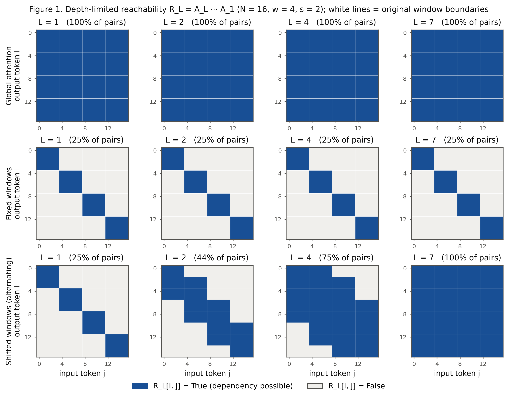
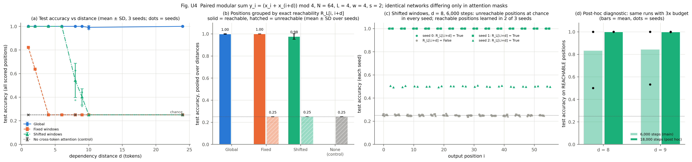
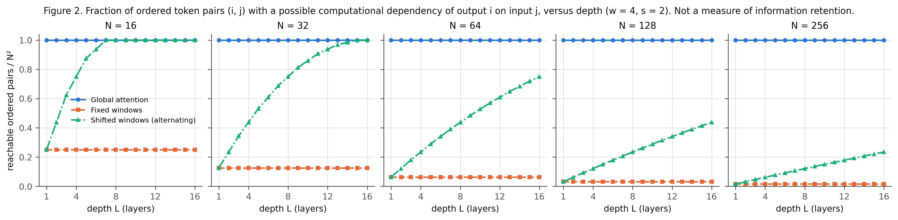
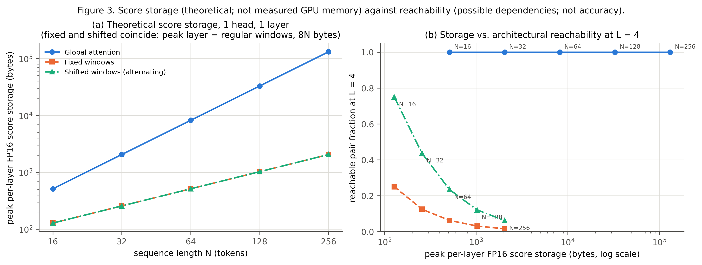

# fmri-attention-memory-study

A controlled study of how fixed-window, shifted-window and global self-attention trade
computational cost for information access across depth. It is motivated by **SwiFT: Swin 4D
fMRI Transformer** (Kim et al., NeurIPS 2023). All experiments use synthetic 1D token
sequences. No fMRI data is used, and SwiFT is **not** reproduced.

**Part I. Exact analysis.** How do fixed and shifted attention windows trade computational
efficiency for cross-window information access as network depth increases?

**Part II. Learning and measured cost.** For Transformers with identical parameters, does exact
depth-limited reachability predict which dependencies a network can learn, and what do the
attention patterns cost when measured on a GPU?

| Quantity | Investigated | Where |
|---|---|---|
| Theoretical attention-score storage | Yes, analytic, checked against explicit partitions | Part I |
| Architectural reachability (which inputs *can* influence which outputs) | Yes, exact Boolean propagation | Parts I and II |
| Learning of long-range dependencies on a synthetic task | Yes, 81 matched training runs | Part II |
| Measured GPU memory and latency of attention cores | Yes, one GPU | Part II |
| Real fMRI data, SwiFT reproduction, prediction of brain phenotypes | No | n/a |



**Figure 1.** Depth-limited reachability `R_L` for N = 16 tokens, window w = 4, shift s = 2.
Row *i* = output token after *L* layers, column *j* = input token; dark = a dependency path
exists. Global attention is complete at L = 1. Fixed windows stay block-diagonal at every depth.
Alternating shifted windows grow a band that reaches all pairs at L = 7.

---

## Part II — Does reachability predict learning, and what does attention cost?

Part II builds on the exact model of Part I (§1–§6 below), whose results are unchanged.

> **For window-attention Transformers with identical parameters, does exact reachability
> `R_L[i, j]` predict which dependencies the network can learn, and what do the attention
> patterns actually cost on a GPU?**

Full documentation is in [`reports/`](reports):
[audit](reports/01_existing_project_audit.md) ·
[direction](reports/02_research_direction.md) ·
[protocol](reports/03_experimental_protocol.md) ·
[results](reports/04_results_and_interpretation.md) ·
[limitations](reports/05_limitations_and_next_steps.md) ·
[summary](reports/06_research_application_summary.md).



**Fig. U4.** Four Transformers identical except for their attention masks (204,676 parameters
each) learn y_i = (x_i + x_{i+d}) mod 4 (N = 64, L = 4, w = 4, s = 2; 81 runs, 3 seeds).

**Key verified results** (all from saved CSVs):

| | Result |
|---|---|
| Necessity | Every position with `R_L[i, i+d] = False` scored at chance (0.249–0.251) in every run and architecture. |
| Learning within reach | Positions reachable within 3 layers: 1.000 test accuracy. Positions reachable only at full depth (d = 8, 9): learned in 2/3 seeds at 6,000 steps; **post-hoc** 18,000-step rerun: 6/6 (≥ 0.997), with unstable training. |
| Growth law (exact, 800/800 configs) | The farthest dependency grows by **w/2 per layer**; the shift s does not change the number of reachable pairs (masked boundary). |
| Theory vs measurement (RTX 4070 Ti SUPER) | Explicit global attention uses about 2× its theoretical score bytes and is OOM at N = 32,768. PyTorch's exact memory-efficient kernel uses 4–8 MiB forward. Windows remain 12–44× faster (fwd+bwd, N = 16,384). FlashAttention is not in this PyTorch build and was **not** measured. |

More figures: [reachability sweep (U2)](figures/upgrade/figU2_reachability_sweep.png) ·
[efficiency, theoretical versus measured (U3)](figures/upgrade/figU3_efficiency.png) ·
[masks per layer (U1)](figures/upgrade/figU1_architecture.png).

**Reproduce Part II** (outputs: `results/sweep/`, `results/learning*/`,
`results/benchmark/`, `figures/upgrade/`):

```bash
pip install -r requirements.txt            # PyTorch: CUDA build from pytorch.org for GPU runs
python -m unittest discover -s tests -v    # 29 tests, CPU, < 1 min
python run_sweep.py                        # Option A, ~15 s
python run_learning.py --config configs/learning_tuning.json --out results/learning_tuning   # LR selection (validation)
python run_learning.py --config configs/learning.json      # 81 runs; ~1.5-2 h on one GPU
python run_learning.py --config configs/learning_followup.json --out results/learning_followup  # post-hoc diagnostic
python summarize_learning.py               # summary tables
python run_benchmark.py                    # CUDA GPU required; run with no other GPU jobs
python make_figures.py                     # figures from saved CSVs only
```

The runs reported here were executed as parallel shards (`--seeds`, `--archs`) and merged with
`run_learning.py --merge`. The tuning results were run per architecture into
`results/learning_tuning/<arch>/`.

---

# Part I — Exact reachability and theoretical storage

## 1. Methodology

**Tokens.** A 1D sequence of N ∈ {16, 32, 64, 128, 256} tokens. This is a deliberately simplified
analogue of SwiFT's *temporal* token axis, where the repository's sample configuration also uses
window 4 and shift 2 (see §5). No fMRI data, no training, no pretrained weights.

**Architectures** (depth L = 1…16):

| Name | Layer *l* adjacency `A_l` |
|---|---|
| Global | all-ones N × N |
| Fixed windows | blocks `[0,4), [4,8), …` at every layer |
| Shifted windows | odd layers: regular blocks; even layers: `[0,2), [2,6), [6,10), …, [N−2,N)` |

**Exact reachability.** `A_l[i,j] = True` iff output token *i* of layer *l* attends to input token *j*.

```
R_0 = I,     R_l = A_l ⊙ R_(l−1)     (⊙ = Boolean product: OR over k of A[i,k] AND R[k,j])
```

Each layer contributes exactly one propagation step. This is depth-limited, **not** a transitive
closure. Every window contains its own token, so `A_l[i,i] = True` and the residual path is
covered. The Boolean product accumulates path counts in `int32`, because a `uint8` product
silently wraps to 0 at 256 paths (a test exercises this).

**Boundary handling.** Swin/SwiFT implement the shifted layer as a cyclic roll by −s plus a
region-label attention mask. After masking, that is equivalent to the non-cyclic partition above,
with two partial windows of size s = 2 at the ends. `src/reachability.py` builds the non-cyclic
partition directly. It also contains an independent 1D re-implementation of the roll +
region-mask procedure (`cyclic_masked_adjacency`), and the tests check that the two are
identical for every N. They also check that the *unmasked* cyclic version (negative control)
does create a spurious 0 ↔ N−1 edge.

**Score storage** (one head, one layer, batch 1, FP16 = 2 bytes, score matrix `QKᵀ` only):

```
M_global = 2·N²                 M_window = 2·Σ_i n_i²   (n_i = actual window sizes)
regular layer:  2·(N/4)·16 = 8N bytes
shifted layer:  2·(2² + 2² + (N/4 − 1)·4²) = 8N − 16 bytes   (actual partition)
                8N bytes if, as in Swin/SwiFT's batched cyclic implementation,
                masked entries are still materialized
```

Figure 3 uses the **peak per-layer** storage across the stack (8N for both window variants).
This counts no activations, Q/K/V, weights, gradients, optimizer state or allocator overhead, so
it is **not** a GPU-memory measurement.

## 2. Results

All numbers below are copied from `results/results.csv` (255 rows) produced by `python run.py`.

**Reachable fraction of ordered pairs (`|R_L|/N²`, self-pairs i = j included)**

| N | Global L=1 | Fixed (any L) | Shifted L=4 | Shifted L=16 | First L with full reach (shifted) |
|---|---|---|---|---|---|
| 16 | 1.000 | 0.250 | 0.750 | 1.000 | 7 |
| 32 | 1.000 | 0.125 | 0.438 | 1.000 | 15 |
| 64 | 1.000 | 0.0625 | 0.234 | 0.750 | > 16 |
| 128 | 1.000 | 0.0313 | 0.121 | 0.438 | > 16 |
| 256 | 1.000 | 0.0156 | 0.0615 | 0.234 | > 16 |

**Peak per-layer FP16 score storage**

| N | Global (2N²) | Fixed / shifted (8N) | Reduction |
|---|---|---|---|
| 16 | 512 B | 128 B | 4× |
| 32 | 2,048 B | 256 B | 8× |
| 64 | 8,192 B | 512 B | 16× |
| 128 | 32,768 B | 1,024 B | 32× |
| 256 | 131,072 B | 2,048 B | 64× |

The reduction is exactly N/w: quadratic versus linear growth.

**Depth laws** for alternating shifted windows (w = 4, s = 2). Each law below holds exactly for
all five N and all L ≤ 16 in the CSV:

- **Interior tokens** gain **w = 4 tokens of receptive field per layer**, alternately on the
  left and right. For example, token 32 at N = 64 has (left, right) reach (0, 3) → (4, 3) →
  (4, 7) → (8, 7). That averages 2 tokens = s per direction per layer, and
  `max_receptive_field` = min(4L, N).
- **The farthest dependency** grows by exactly 2 tokens per layer: max |i − j| = min(2L + 1, N − 1)
  (`max_token_distance`).
- **Boundary tokens** grow more slowly: `min_receptive_field` = min(4⌈L/2⌉, N). On shifted
  layers the partial edge windows add nothing new.
- **Full reachability** first occurs at L = (N − 2)/2: L = 7 for N = 16 and L = 15 for N = 32. An
  audit computation beyond the experimental grid also gave L = 31 for N = 64. For N = 128 and 256
  this is an extrapolation (63 and 127 layers). It is not attained within L ≤ 16. Depth therefore
  grows linearly with N.
- **Fixed windows** never cross their original boundaries at any depth (fraction = w/N).

Only s = w/2 was tested, so these results cannot separate a dependence on s from a dependence
on w/2.



**Figure 2.** Reachable-pair fraction versus depth. Reachability means a *possible* computational
dependency: a path of nonzero attention edges exists. It does not say the information is retained
or used after training.



**Figure 3.** (a) Theoretical per-layer score storage versus N (log–log). (b) Storage against
reachability at L = 4. Window attention costs O(N) storage but needs O(N) depth to connect all
pairs; global attention costs O(N²) but connects all pairs in one layer. Panel (b) shows a
trade-off between two architectural quantities. It does not claim that reachability predicts
accuracy, or that memory savings cause information loss.

### Scale-up illustration: SwiFT's input (separate calculation; not a model of SwiFT)

`results/swift_scale_illustration.csv`. Input 96³ × 20 frames, patch [6, 6, 6, 1] gives a stage-1
token grid of 16 × 16 × 16 × 20 = **81,920 tokens**.

| Per head, per layer, FP16 scores only | Value |
|---|---|
| Hypothetical global attention over all stage-1 tokens: 2 · 81,920² | 13,421,772,800 B ≈ **13.4 GB** (12.5 GiB) |
| 4D windows 4×4×4×4 = 256 tokens; 4·4·4·5 = 320 windows: 2 · 320 · 256² | 41,943,040 B ≈ **41.9 MB** |
| Reduction | **320×** (= tokens / window size) |

This is the same arithmetic as the 1D experiment applied to a 4D grid. It is illustrative only.
SwiFT never applies global attention at stage 1, and the figure excludes heads, batch, and every
other memory term.

## 3. Connection to Original Research

Source files were read at pinned commits through the GitHub API. No repository was cloned and no
code was copied. The NumPy implementation here is written independently.

| Repository (license, commit) | Relevant source | What we verified / how we differ |
|---|---|---|
| **SwiFT**, Transconnectome/SwiFT (Apache-2.0, [`0b07cb1`](https://github.com/Transconnectome/SwiFT/tree/0b07cb156d77a7de33078c8f6fe3ddffa7b5ae9c)) | [`swin4d_transformer_ver7.py`](https://github.com/Transconnectome/SwiFT/blob/0b07cb156d77a7de33078c8f6fe3ddffa7b5ae9c/project/module/models/swin4d_transformer_ver7.py): `get_window_size` (L110–134), `SwinTransformerBlock4D.forward_part1` roll/partition/mask (L265–300), `compute_mask` (L362–391), shift = window // 2 and alternation `no_shift if i % 2 == 0` (L436, L446), `PatchMergingV2` spatial-only merging (L340), final-stage window (L769–774). Defaults: [`pl_classifier.py`](https://github.com/Transconnectome/SwiFT/blob/0b07cb156d77a7de33078c8f6fe3ddffa7b5ae9c/project/module/pl_classifier.py) L506–512; [`sample_script.sh`](https://github.com/Transconnectome/SwiFT/blob/0b07cb156d77a7de33078c8f6fe3ddffa7b5ae9c/sample_scripts/sample_script.sh) L9, L17 | Our shift schedule (unshifted first, then alternating, shift = w/2) and our region mask match this code. With `--window_size 4 4 4 4`, the temporal axis uses w = 4, s = 2, exactly our setting. Because 4D windows and region labels are Cartesian products over axes, single-axis reachability is a valid *slice* of the 4D connectivity. It does **not** include spatial patch merging, the 4D window product, hierarchical stages, or the final stage. |
| **Swin Transformer**, microsoft/Swin-Transformer (MIT, [`f82860b`](https://github.com/microsoft/Swin-Transformer/tree/f82860bfb5225915aca09c3227159ee9e1df874d)) | [`models/swin_transformer.py`](https://github.com/microsoft/Swin-Transformer/blob/f82860bfb5225915aca09c3227159ee9e1df874d/models/swin_transformer.py): `SwinTransformerBlock` mask construction (L222–243), cyclic roll (L260) and reverse roll (L282) | Origin of the cyclic-shift-plus-mask trick. `cyclic_masked_adjacency` is a 1D re-derivation of it. A test proves it equals our non-cyclic partition, so no wraparound edges exist. |
| **FlashAttention**, Dao-AILab/flash-attention (BSD-3-Clause, [`68bd095`](https://github.com/Dao-AILab/flash-attention/tree/68bd095cdd338c5171bccb9c200529f3620b85c9)) | [`flash_attn/flash_attn_interface.py`](https://github.com/Dao-AILab/flash-attention/blob/68bd095cdd338c5171bccb9c200529f3620b85c9/flash_attn/flash_attn_interface.py) `flash_attn_func` (L1156; `window_size=(-1, -1)` = infinite context); kernels [`csrc/flash_attn/src/flash_fwd_kernel.h`](https://github.com/Dao-AILab/flash-attention/blob/68bd095cdd338c5171bccb9c200529f3620b85c9/csrc/flash_attn/src/flash_fwd_kernel.h), [`softmax.h`](https://github.com/Dao-AILab/flash-attention/blob/68bd095cdd338c5171bccb9c200529f3620b85c9/csrc/flash_attn/src/softmax.h) (tiled, online softmax) | FlashAttention computes **exact** attention without materializing the N × N score matrix. With default arguments its connectivity is identical to our *global* row, so it changes the memory term, not reachability. Its optional `window_size` gives a sliding (per-query) band, which is a different pattern from Swin's block windows and is not modeled here. No FlashAttention measurements are reported. |

**Two observations from reading the code** (stated as code reading only; we did not run SwiFT):

1. Swin and SwiFT add **−100** to masked scores rather than −∞. After softmax, masked weights are
   about e⁻¹⁰⁰ ≈ 4 × 10⁻⁴⁴ relative, which is effectively zero (it underflows to 0 in FP16) but not
   exactly zero in FP32. Our Boolean model treats the mask as hard, which is the intended
   semantics.
2. With `--last_layer_full_MSA True`, the final-stage window at this commit is
   `(grid/8, grid/8, grid/8, window_size[3])`. For the sample configuration that is spatially
   global (2×2×2) but still temporally windowed (4 frames, unshifted), since T = 20 > 4. Anyone
   relating SwiFT's stage-4 "global attention" to temporal reach should check this against the
   configuration they actually run.

**How the 1D model differs from SwiFT.** SwiFT uses 4D (3 spatial + time) windows, spatial patch
merging between four hierarchical stages (spatial window coverage grows from 24³ to 96³ voxels),
learned multi-head attention with MLPs and LayerNorm, positional embeddings, and a final
global-attention stage. We model only the binary connectivity of one axis with a fixed
alternating schedule. The paper's statement that shifting lets a token interact with tokens
"about 10 time frames away" is **not** reproduced or tested here.

## 4. Limitations

- Reachability is an upper bound on dependence. A finite-difference check on a small NumPy
  masked-softmax attention network (random, untrained weights; residual + tanh) found output
  changes of exactly 0 for every pair outside `R_L`. Some pairs inside `R_L` changed by ≤ 1e-12,
  because the softmax saturated. So a reachable pair may carry negligible influence, and in a
  trained network this depends on the learned weights.
- Attention is the only cross-token operation modeled. MLP and LayerNorm act per token and add
  no cross-token edges.
- Score storage is a theoretical count of one tensor. Real peak GPU memory depends on
  activations, kernels (e.g. FlashAttention), precision, batch size and the framework.
- 1D, single head, a single fixed schedule (w = 4, s = 2), no patch merging, no global stage.
- No real fMRI data. No claims about neuroscience findings or prediction performance.

## 5. Reproducibility

```bash
pip install -r requirements.txt
python -m unittest discover -s tests -v   # 29 tests (16 Part I + 13 Part II)
python run.py                             # writes results/*.csv and figures/*.png (300 DPI)
```

Fully deterministic (no randomness in the experiment). Runs in a few seconds on a CPU.

```
src/reachability.py   window partitions, Swin-style reference, Boolean propagation, components
src/memory.py         analytic score storage + SwiFT-scale illustration
src/visualize.py      Figures 1–3 (original study)
src/sweep.py          Option A: reachability sweep
src/synthetic_task.py Option C: paired-modular-sum data
src/torch_models.py   Option C: masked Transformer (masks = exact A_l)
src/learning.py       Option C: training / validation selection / per-position test
src/attention_ops.py  Option B: attention cores (+ dense masked reference)
src/benchmark.py      Option B: memory and latency measurement
configs/*.json        every experiment's settings (seeds included)
tests/test_reachability.py, tests/test_upgrade.py
run.py, run_sweep.py, run_learning.py, run_benchmark.py, summarize_learning.py, make_figures.py
reports/01-06         audit, direction, protocol, results, limitations, application summary
```

Tests cover: R₀ = I; global is full at L = 1; fixed windows never cross boundaries; shifted
reachability is monotone non-decreasing with depth; each layer adds at most one window of
reach; the exact depth laws quoted in §2 for all five N; no dependency outside `R_L` in an
actual masked-softmax attention network; non-cyclic partition = Swin roll + mask, with no wraparound; unmasked cyclic control
does wrap; Boolean product has no overflow; a hand-derived N = 8 example; multiplication order
(A₂A₁ ≠ A₁A₂); analytic storage = explicit partition counts; SwiFT-scale arithmetic;
determinism.

## 6. Takeaway

Window attention turns quadratic score storage into linear storage (N/w smaller per layer: 64×
at N = 256). It pays for this in **depth**. Fixed windows never exchange information. Alternating
shifted windows widen an interior token's possible dependencies by one window (4 tokens) per
layer, alternating sides, and the farthest dependency by only 2 tokens per layer. Connecting a
whole sequence therefore takes depth that grows linearly with its length (L = (N − 2)/2 here). That is why
SwiFT-style designs add hierarchical patch merging and a final global stage rather than relying
on shifts alone. Exact global-attention kernels such as FlashAttention avoid materializing the
N × N score matrix without changing global attention's one-layer connectivity.

## Authorship and AI assistance

- **Author's contributions.** The author defined the research questions and the experimental
  design requirements (sequence lengths, window and shift settings, metrics, required
  validation tests). The author also set the scientific-integrity constraints (what may and may
  not be claimed), chose the direction of the follow-up study, and requested the independent
  audits that led to the corrections documented in `reports/01` and `reports/04`.
- **AI-assisted work.** Code, tests, experiment execution, figure generation and first drafts
  of the README and reports were produced with AI assistance (Claude, Anthropic, via Claude
  Code), under the author's direction.
- **Provenance of results.** Every reported number is computed by the code in this repository
  and read from the saved files in `results/`. No result was entered by hand. Errors found
  during the work are documented rather than removed, e.g.
  `results/benchmark_run1_invalid_sysmem_spill/`.

## References

1. Kim, P. Y., Kwon, J., Joo, S., Bae, S., Lee, D., Jung, Y., Yoo, S., Cha, J., & Moon, T. (2023).
   *SwiFT: Swin 4D fMRI Transformer.* Advances in Neural Information Processing Systems 36.
   arXiv:2307.05916. Code: https://github.com/Transconnectome/SwiFT
2. Liu, Z., Lin, Y., Cao, Y., Hu, H., Wei, Y., Zhang, Z., Lin, S., & Guo, B. (2021). *Swin
   Transformer: Hierarchical Vision Transformer using Shifted Windows.* Proceedings of the
   IEEE/CVF International Conference on Computer Vision (ICCV), 10012–10022. arXiv:2103.14030.
   Code: https://github.com/microsoft/Swin-Transformer
3. Dao, T., Fu, D. Y., Ermon, S., Rudra, A., & Ré, C. (2022). *FlashAttention: Fast and
   Memory-Efficient Exact Attention with IO-Awareness.* Advances in Neural Information Processing
   Systems 35. arXiv:2205.14135. Code: https://github.com/Dao-AILab/flash-attention
